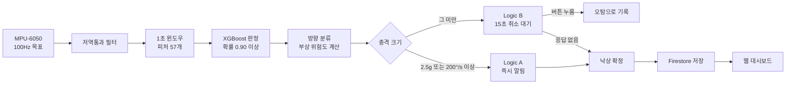

# Fall Guard

허리에 차는 벨트의 가속도·자이로 센서(MPU-6050) 값을 라즈베리파이 5에서 읽어 XGBoost로 낙상을 판정하고, 넘어진 방향에 따른 부상 위험도와 조치 안내를 Firebase로 보내 웹 대시보드에 보여주는 낙상 감지 시스템입니다. 2026년 3월~6월에 진행한 캡스톤 프로젝트이고, 5인 팀 중 개발에 참여한 3명이 만들었습니다.

## 동작 방식



- 센서를 100Hz(목표)로 읽어 6축마다 저역통과 필터(alpha 0.3)를 거칩니다.
- 1초(100샘플) 윈도우에서 피처 57개를 뽑아 XGBoost가 낙상 확률을 계산합니다.
- 확률이 0.90 이상이면 낙상 후보로 보고 낙상 방향(앞/뒤/옆)을 분류한 뒤, 방향·나이·충격 크기로 부상 위험도를 계산합니다.
- 충격이 크면 바로 알리고, 작으면 15초 동안 버튼으로 취소할 수 있습니다. 취소된 이벤트는 오탐 기록으로 따로 저장합니다.
- 확정된 낙상은 Firestore에 저장되고, 팀원이 만든 웹 대시보드에서 확인합니다.

## 결과

- 피험자 단위로 나눈 시험 데이터 기준 민감도 92.79%, AUC-ROC 99.50% (학습 데이터는 KFall, SisFall 약 22만 개와 직접 측정 350개)
- Random Forest(민감도 86.15%)보다 XGBoost(90.53%)를 골랐습니다. 낙상을 놓치는 것이 오탐보다 위험해서 민감도를 우선했습니다.
- 공개 데이터는 실험실 환경이라, 실제 착용 환경의 일상 동작 데이터 350개를 직접 측정해 합쳐서 재학습했습니다.

## 하드웨어

- Raspberry Pi 5
- MPU-6050 (I2C)
- NEO-6M GPS (아두이노 우노 경유 USB)
- 푸시 버튼 (GPIO 17), 피에조 부저 (GPIO 27)

## 실행 준비

- `firebase_key.json`, `xgb_model.pkl`, `xgb_direction_model.pkl`, `xgb_feature_cols.pkl`을 `firestore_detection.py`와 같은 폴더에 둡니다.
- `retrain_xgboost.py`의 결과물은 `XGBoost_Model` 폴더에 저장됩니다. 재학습 후에는 생성된 pkl 파일들을 `firestore_detection.py`가 있는 폴더로 복사하세요.
- 재학습에는 `combined_features.csv`와 `custom_data_20260520_174846.csv`(파일 이름은 `retrain_xgboost.py`의 `CUSTOM_CSV`와 같아야 합니다)가 필요합니다.

## 설치 및 실행

```bash
python3 -m venv .venv
source .venv/bin/activate
pip install -r requirements.txt
python3 firestore_detection.py
```

## 파일 구조

```
fall-guard-belt/
├── firestore_detection.py     # 실시간 감지 메인 코드 (약 970줄)
├── data_collection.py         # 직접 데이터 수집
├── retrain_xgboost.py         # 모델 학습·재학습
├── requirements.txt
└── .gitignore
```

아래 파일은 `.gitignore`로 제외되어 있어 직접 준비해야 합니다.

| 파일 | 설명 | 제외 이유 |
|---|---|---|
| `firebase_key.json` | Firebase 서비스 계정 키 | 보안 |
| `xgb_model.pkl`, `xgb_direction_model.pkl`, `xgb_feature_cols.pkl` | 학습된 모델과 피처 목록 | 용량 |
| `*.csv` | 학습·수집 데이터셋 | 용량 |

## 부상 위험도 규칙

방향별 기본 위험 레벨(낮음~매우높음)을 논문을 참고해 직접 정하고, 나이(65세 이상 +1, 75세 이상 +2)와 충격 크기(5g 이상 +1, 1g 미만 -1)로 보정합니다. 부위 중 가장 높은 레벨이 전체 등급입니다. 임상 검증을 거치지 않은 자체 규칙입니다.

<details>
<summary>참고한 논문</summary>

- Nevitt & Cummings (1993), JAGS: 옆으로 또는 곧장 주저앉듯 넘어질 때 고관절 골절, 뒤로 넘어질 때 손목 골절이 많았음 (고령 여성 대상)
- Berry & Miller (2008), Curr Osteoporos Rep (리뷰): 고관절 골절은 옆으로 넘어질 때 더 많이 연관됨
- Greenspan et al. (1994), JAMA: 낙상 방향, 골밀도, 낙상 시 위치에너지 등이 고관절 골절의 위험요인
- Lo & Ashton-Miller (2008), J Biomech: 충격력과 골절 한계의 비율로 위험을 평가하는 방식 참고
- Rowson & Duma (2013), Ann Biomed Eng: 선형·회전 가속도를 함께 쓰는 아이디어 참고

</details>

<details>
<summary>Firebase 데이터 구조</summary>

```
patients/{patient_id}
  → name, age, medical_history, guardian_contact

fall_events/{patient_id}/events/{event_id}
  → fall_probability, fall_direction, acc_max_g, gyr_max_dps
  → location, reason, main_injury, first_aid_guide

injury_risk/{patient_id}/events/{event_id}
  → 고관절_골절, 손목_골절, 뇌진탕, 허리_부상, 어깨_부상, 위험_등급

alerts/{event_id}
  → patient_id, direction, risk_grade, confirmed
```

</details>

## 한계

- 직접 측정한 데이터는 일상 동작뿐입니다. 낙상 데이터는 안전상 매트 위에서만 수집할 수 있어 실제 착용 환경의 낙상 데이터는 없고, 오탐을 완전히 해결하지 못했습니다.
- 실시간 감지에는 저역통과 필터를 쓰지만, 직접 측정한 학습 데이터에는 적용하지 않았습니다.
- 부상 위험도는 논문을 참고한 자체 규칙이며 임상 검증을 거치지 않았습니다.
- 배터리 잔량은 시뮬레이션 값입니다.

## 개발 참여자

5인 팀 중 개발에 참여한 3명입니다.

| 이름 | 역할 |
|---|---|
| 이상훈 (팀장) | AI 모델, 데이터 전처리, 실시간 감지 코드, 하드웨어 세팅, 부상 위험도 규칙 |
| 정영진 | 웹 대시보드, Firebase 연동, 카카오맵 |
| 이승호 | 하드웨어 제작, 발표 자료 |

2026 WON+PBL 챌린지 대학혁신단장상(3등) 수상작
